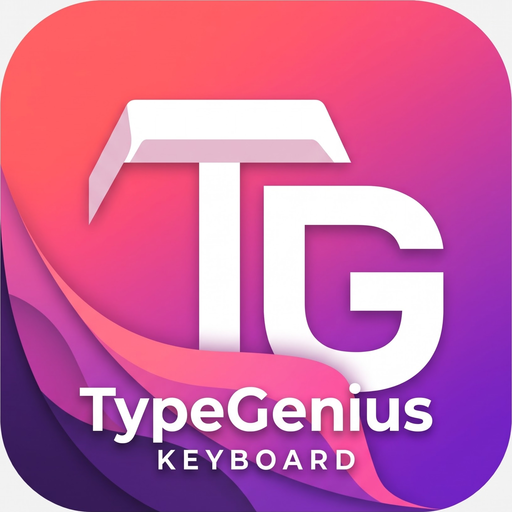

<div align="center">



# TypeGenius Keyboard

**Smart, Fast & 100% Privacy-First Offline Multilingual Android Keyboard**

*Built with Jetpack Compose, Material 3, Room SQLite & On-Device Engines*

**Developed by [IT Amadersomaj Inc.](#company--license)** • Package: `com.itamadersomajinc.typegenius` • Version `1.0`

[-3DDC84?style=for-the-badge&logo=android&logoColor=white)](https://developer.android.com)
[](https://kotlinlang.org)
[](#-architecture--privacy)
[](#-supported-keyboard-layouts-33-packages)
[](#-on-device-offline-translator-38-languages)

[Features](#-key-features) • [Layouts](#-supported-keyboard-layouts-33-packages) • [Offline Translator](#-on-device-offline-translator-38-languages) • [Voice & AI](#-1-tap-continuous-voice--typegenius-ai) • [Build & Test](#-build--test) • [বাংলা গাইড (Guide)](./KEYBOARD_GUIDE.md)

</div>

---

## ✨ Overview

**TypeGenius Keyboard** is a modern, lightweight, privacy-centric Android Input Method Editor (`InputMethodService`) built entirely in **Kotlin** and **Jetpack Compose** by **IT Amadersomaj Inc.**

Designed from the ground up for Bengali, Sylheti, South Asian, Middle Eastern, and Global users, TypeGenius runs **100% offline with zero servers, zero telemetry, and zero third-party analytics**. Every word prediction, Avro phonetic transliteration, offline translation, grammar check, handwriting font style, clipboard history entry, and keypress sound synthesis executes locally on your device.

> Want a deep dive in Bengali covering how the keyboard works internally and step-by-step usage? Read **[KEYBOARD_GUIDE.md](./KEYBOARD_GUIDE.md)**.

---

## 🚀 Key Features

### ⌨️ 1. 33 Language Layouts (Including 5 Dedicated Bengali & Sylheti Engines)
- **Bengali (Avro Phonetic / অভ্র ফোনেটিক)**: Real-time phonetic parser (`ami → আমি`, `kobita → কবিতা`, `krishi → কৃষি`, conjuncts, reph, phola) with Bengali key sub-hints right on the QWERTY keys and instant Bangla composing.
- **Bengali (Probhat / প্রভাত)**: Classic layout with long-press `ExtraVariants` for all kars, reph (`র্`), yaphola (`্য`), raphola (`্র`), and conjunct components.
- **Bengali (UniBijoy / ইউনিবিজয়)** & **Bengali (National / জাতীয়)**: Mobile-optimized classic layouts with full vowel, kar, and consonant coverage.
- **Sylheti (Syloti Nagri & Bangla / সিলেটি • ꠍꠤꠟꠐꠤ)**: Dedicated Syloti Nagri (`ꠍꠤꠟꠐꠤ ꠘꠣꠉꠞꠤ`) primary keys paired with Bangla script equivalents.
- **Full RTL & International Coverage**: Arabic (`العربية`), Urdu (`اردو`), Persian (`فارسی`), Hebrew (`עברית`), Hindi, Assamese, Nepali, Sanskrit, Marathi, Tamil, Telugu, Gujarati, Punjabi, Malayalam, Kannada, English (US/UK), Spanish, French, German, Portuguese, Italian, Turkish, Russian, Indonesian, Malay, Korean, and Japanese Kana.

### 🌐 2. On-Device Offline Translator (38 Languages + Downloadable Packs)
- **In-Keyboard Docked Live Translator**: Translate directly inside any chat app (WhatsApp, Messenger, Gmail, etc.) and insert, copy, or share output in one tap.
- **38 Supported Languages**:
  - **22 Built-In Core Languages** (Bengali, Banglish, English, Sylheti, Hindi, Arabic, Urdu, Persian, Spanish, French, German, Portuguese, Italian, Russian, Turkish, Indonesian, Malay, Assamese, Nepali, Japanese, Korean, Chinese Simplified).
  - **16 Downloadable Offline Language Packs** (Tamil, Telugu, Marathi, Gujarati, Punjabi, Malayalam, Kannada, Thai, Vietnamese, Dutch, Polish, Ukrainian, Greek, Swedish, Swahili, Hebrew) — cached locally in internal storage with single-pack or **Download All** controls and persistent Room SQLite Translation Memory.
- **Automatic Script & Dialect Detection**: Detects Banglish (`ami bangla valobashi`), Sylheti romanized (`afne bala achoinni`), Bengali, Arabic, CJK, Cyrillic, Devanagari, Tamil, Thai, and more.

### 🎙️ 3. 1-Tap Continuous Voice Typing (`Auto ∞`)
- **Tap Once, Keep Speaking**: Start voice dictation with a single tap on the microphone icon — no repeated mic presses between sentences or pauses.
- **Resilient Continuous Loop**: Automatically chains recognition cycles across natural pauses, flushes uncommitted partial speech if a cycle times out, and stops only when you tap Stop/Close or dismiss the keyboard.
- **Live Equalizer & Language Auto-Mapping**: Real-time RMS audio waveform visualizer tuned for `bn-BD`, `en-US`, `hi-IN`, `ar`, and all active keyboard languages.

### 🔊 4. Synthesized SoundPool Keypress Engine (5 Profiles)
- Low-latency **RIFF/WAV synthesis + `SoundPool` (`USAGE_MEDIA`)** cached in app storage so keypress audio stays crisp and audible **even when Android's system Touch Sounds setting is muted**:
  1. `Default Android Click`
  2. `Mechanical Clicky (Blue Switch)`
  3. `Vintage Typewriter` (including return bell on Enter)
  4. `Creamy Thock`
  5. `Bubble Pop / iOS Crisp`

### ✨ 5. TypeGenius AI & Optional Direct Gemini Client
- **100% Offline Writing Tools**: Proofread grammar/spelling (`Check`), `Shorten`, `Formal`, `Casual`, `Native` (Banglish → Bengali script), `English` translation with "Read As" back-translation, and user-defined **Custom AI Prompts**.
- **Optional BYO Gemini Key**: Users may optionally add their own Google Gemini API key (`aistudio.google.com`) for direct device-to-Google API requests with automatic multi-model fallback (`gemini-2.5-flash` → `gemini-2.0-flash` → `gemini-2.5-flash-lite` → `gemini-2.0-flash-lite`).

### ✍️ 6. Handwriting Fonts & Stylish Unicode Studio
- Bundled local `.ttf` fonts (**Atma Handwriting** & **Galada Calligraphy**) plus user-imported custom `.ttf`/`.otf` fonts for live keyboard UI styling.
- **20+ Unicode Fancy Font Styles** (`𝐁𝐨𝐥𝐝`, `𝓐𝓫𝓬`, `𝔗𝔶𝔭𝔢`, `🄷🄸`, `ⓐⓑⓒ`, Underline, Strikethrough, and Bangla Royal/Star Frames `✦ বাংলা ✦`, `꧁ সিলেট ꧂`) that can style live typing or transform the last word.

### 🛠️ 7. Pro Productivity Suite
- **Text Editing Panel**: Directional cursor D-pad, word/sentence selection (`Select All`, `Shift` select), **Cut**, **Copy**, **Paste**, `Clear/Backspace`, `Move Home/End`, and one-tap **Undo Delete**.
- **Smart Clipboard & OTP Extractor**: Pin clips, auto-extract OTP codes, URLs, and emails as one-tap suggestion chips (paused automatically in **Incognito Private Mode**).
- **Offline Math & Mini Calculator**: Evaluate expressions inline (`12+8=`, `(25*4)-10=`, Bengali digits `১২+৮=`) or open the docked Mini Calculator + Unit/Currency Converter (`USD → BDT`, etc.).
- **Glide Swipe Typing & Gestures**: On-device monotonic path-alignment Glide engine supporting both English and Banglish/Avro, Spacebar swipe language switching, and Backspace swipe word-delete.
- **Adaptive Ergonomics & Themes**: 7 themes (including **Material You** dynamic wallpaper tint & custom background photo theme with dim/opacity sliders), Left/Right/Split one-handed modes, Floating keyboard, customizable drag-and-drop Top Toolbar, Notepad + Saved Templates, and local Typing Speed (WPM) analytics.

---

## 🌍 Supported Keyboard Layouts (33 Packages)

| Region | Included Layouts |
| :--- | :--- |
| **Bangladesh & India** | Bengali (Probhat), Bengali (Avro Phonetic), Bengali (National / Jatiya), Bengali (UniBijoy), Sylheti (Syloti Nagri & Bangla), Assamese, Hindi, Nepali, Marathi, Sanskrit, Tamil, Telugu, Gujarati, Punjabi, Malayalam, Kannada |
| **Middle East (RTL)** | Arabic (`العربية`), Urdu (`اردو`), Persian (`فارسی`), Hebrew (`עברית`) |
| **Global & Europe** | English (US), English (UK), Spanish, French, German, Portuguese, Italian, Turkish, Russian |
| **East & SE Asia** | Indonesian, Malay, Korean, Japanese (Kana) |

---

## 🏗️ Architecture & Privacy

TypeGenius follows a strict **100% Backendless MVVM / Service Architecture**:

```text
app/src/main/java/com/example/
├── MainActivity.kt                  # Edge-to-edge Companion App (Home, Layout, Gestures, Languages, Settings, About)
├── model/KeyboardModels.kt          # 33 LanguageId packages, SoundProfile, KeyboardTheme, KeyboardToolId
├── service/
│   ├── TypeGeniusIME.kt             # InputMethodService, InputConnection, Avro composing, Shortcuts, Clipboard
│   ├── KeySoundEngine.kt            # Singleton PCM->WAV synthesizer + SoundPool audio engine
│   └── VoiceInputController.kt      # 1-Tap continuous SpeechRecognizer loop with partial flush & RMS tracking
├── data/
│   ├── SettingsManager.kt           # Jetpack DataStore (Preferences)
│   ├── TypingStatsManager.kt        # Local WPM, word counts, script ratios
│   ├── CustomFontManager.kt         # Local TTF/OTF importer
│   ├── local/                       # Room SQLite v3 (LearnedWords, ClipboardItems, TextShortcuts, TranslationMemory)
│   ├── phonetic/                    # BengaliPhoneticParser.kt (Avro engine + Banglish dictionary + romanizer)
│   ├── dictionary/                  # DictionaryManager, OfflineGlideEngine, OfflineGrammarEngine, OfflineSpellChecker, UnicodeTextStyler, BigramPredictionEngine, EmojiPredictionEngine, OfflineMathEvaluator
│   ├── translator/                  # OfflineTranslator, LocalTranslationEngine, LocalTranslationGrammar, TranslationPackManager
│   └── ai/                          # TypeGeniusAiEngine (offline rules) & GeminiDirectClient (optional BYO key)
└── ui/
    ├── app/                         # CompanionScreens, AboutAppScreen, StylishFontStudioSection, HandwritingFontCard
    ├── keyboard/                    # KeyboardView, KeyboardTopBar, KeyboardLayouts, KeyboardToolPanels, KeyboardTranslatorOverlay, GemTypeAiPanel, EmojiAndClipboardPanels, FancyFontsPanel, SpacebarComponent
    └── theme/                       # Material 3 Theme, Dynamic ColorScheme, Local Fonts (atma.ttf, galada.ttf)
```

### Privacy Guarantees
- No analytics SDKs, no crash uploaders, no remote telemetry databases.
- Incognito Mode immediately suspends local word learning and clipboard logging.
- Personal Dictionary, Shortcuts, Clipboard History, Translation Memory, and Typing Stats reside exclusively in device-private Room SQLite / Jetpack DataStore.

---

## 🛠️ Tech Stack

- **Language**: Kotlin (Coroutines, Flow)
- **UI**: Jetpack Compose + Material Design 3 + Edge-to-Edge (`WindowInsets.safeDrawing`)
- **Storage**: Room SQLite (`version = 3`) + Jetpack Preferences DataStore
- **Audio & Voice**: Android `SoundPool` + `AudioTrack` PCM WAV Synthesizer + `SpeechRecognizer`
- **Testing**: JUnit 4 + Robolectric (`sdk = 36`)

---

## 🧪 Build & Test

Ensure Android SDK & Gradle are available, then run:

```bash
# Run all JVM Unit Tests & Robolectric Integration Tests
gradle :app:testDebugUnitTest

# Build Debug APK
gradle :app:assembleDebug
```

Output APKs are placed at:
- `app/build/outputs/apk/debug/app-debug.apk`
- `./app-debug.apk` (root convenience copy)
- `./.build-outputs/app-debug.apk`

---

## 🏢 Company & License

**TypeGenius Keyboard** is designed, engineered, and maintained by **IT Amadersomaj Inc.**

- **Organization**: IT Amadersomaj Inc.
- **Application ID**: `com.itamadersomajinc.typegenius`
- **Documentation**: [README.md](./README.md) • [KEYBOARD_GUIDE.md](./KEYBOARD_GUIDE.md)
